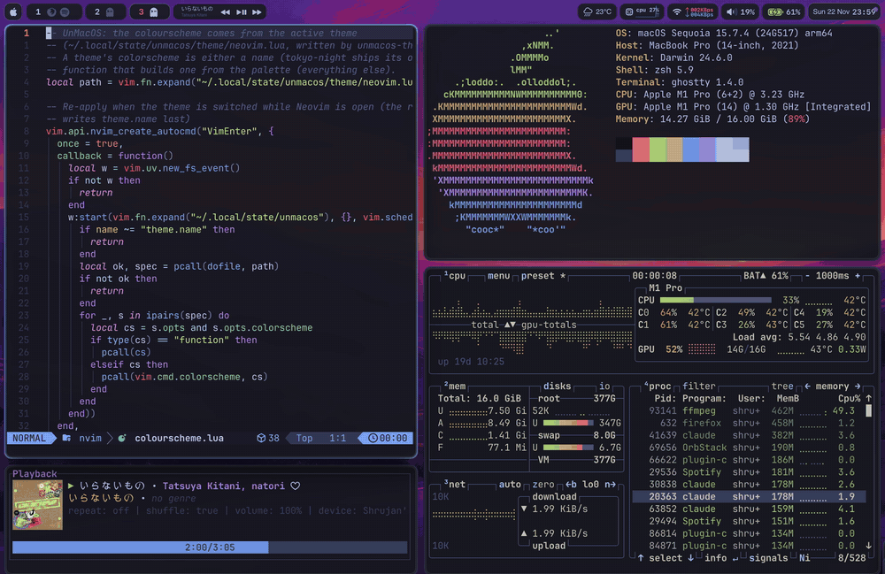
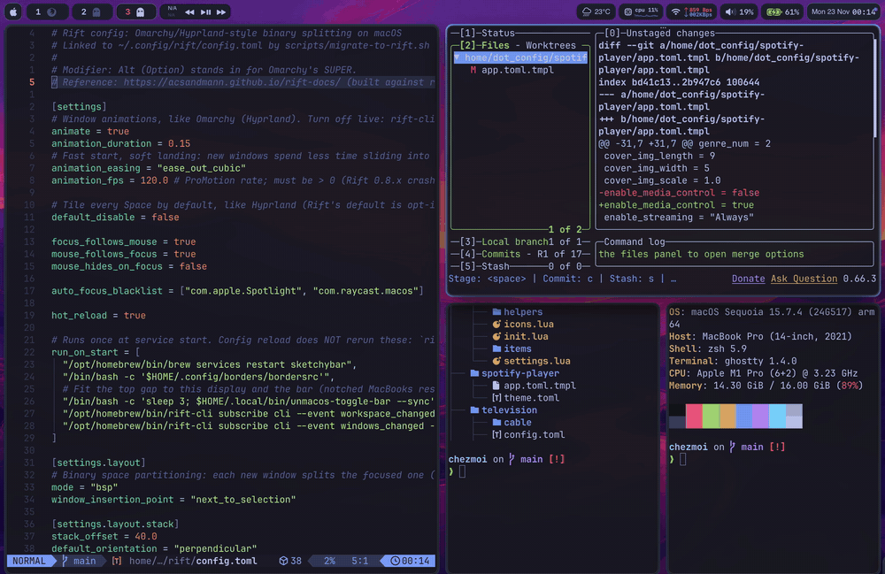
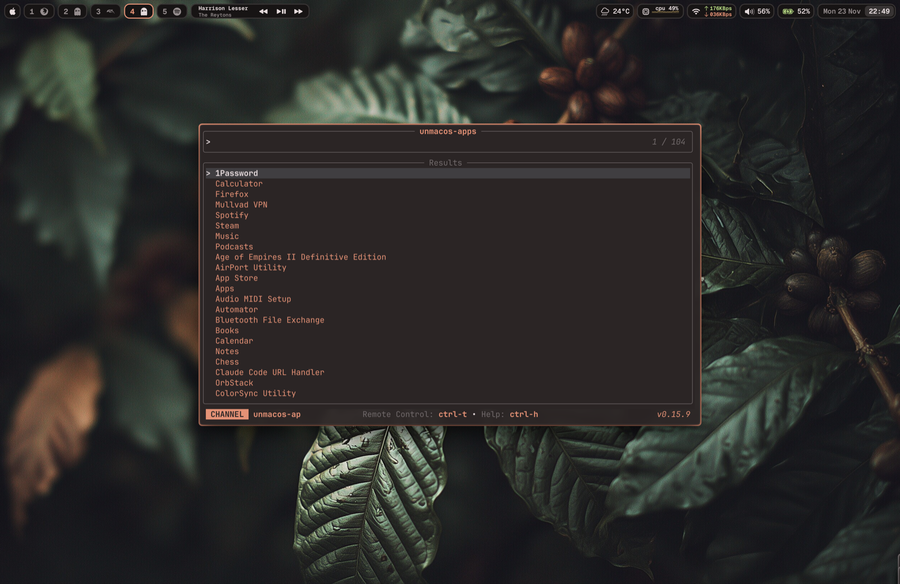
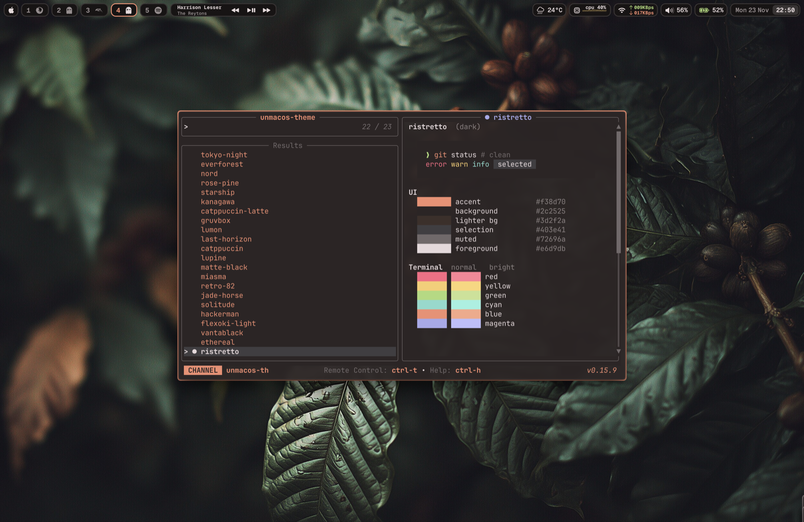
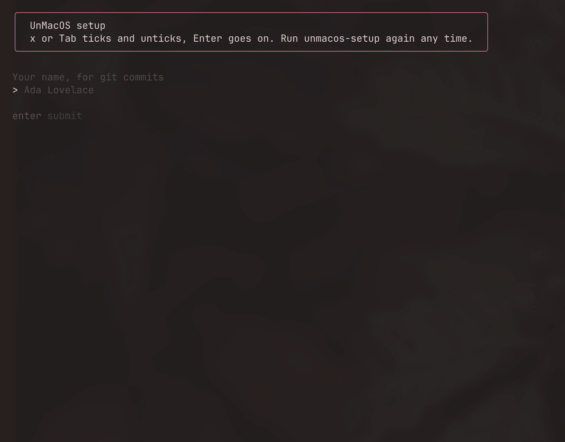
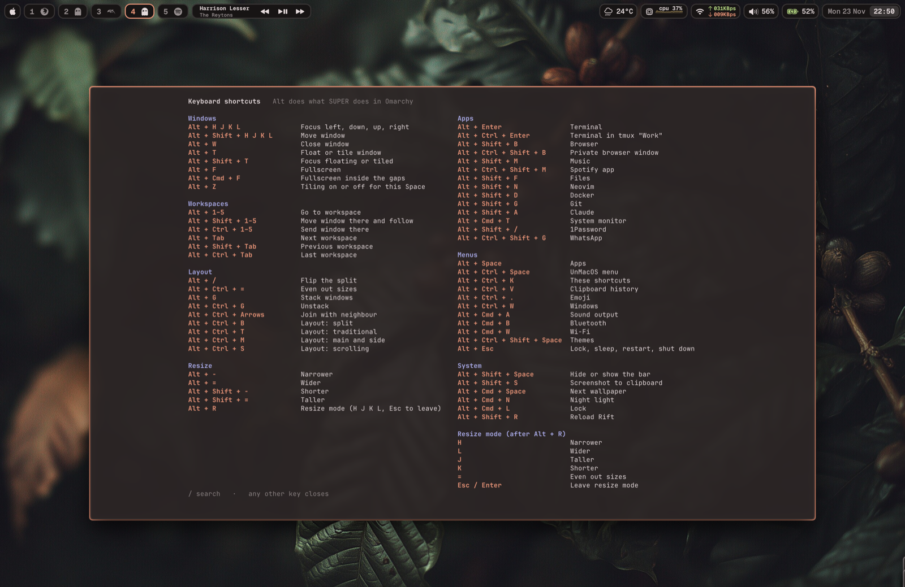

<div align="center">

# UnMacOS

### macOS is built for a trackpad. This is the desktop for the keyboard.

**Tiling windows, instant fuzzy menus, terminal apps and one theme across the whole screen, switched live. [Omarchy](https://omarchy.org)-inspired workflow on a Mac, installed with one command.**

[](https://www.apple.com/macos/)
[](https://github.com/acsandmann/rift)
[](https://github.com/FelixKratz/SketchyBar)
[](https://www.chezmoi.io/)
[](LICENSE)



</div>

```sh
bash -c "$(curl -fsSL https://raw.githubusercontent.com/shrujancheruku/unmacos/main/install.sh)"
```

**[Website](https://shrujancheruku.github.io/unmacos/)** · [What you get](#what-you-get) · [Install](#install) · [Keys](#learn-the-keys) · [Make it yours](#make-it-yours) · [Under the hood](#under-the-hood)

## Why

UnMacOS is a keyboard-first tiling desktop for macOS 15 to 27: dotfiles that set up the Rift tiling
window manager, SketchyBar, fuzzy menus, terminal apps and live theme switching on Apple silicon Macs.

macOS is a great operating system under a desktop designed for dragging. Windows pile up until you
arrange them by hand, apps live in a Dock you aim at, settings sit three clicks deep, and every app
picks its own colours. That suits a trackpad. It gets in the way if you'd rather keep your hands
on the keyboard.

UnMacOS keeps the operating system and replaces the desktop:

| | Stock macOS | UnMacOS |
|---|---|---|
| **Windows** | Drag and resize each one | They tile themselves; move them with `Alt + H J K L` |
| **Apps** | Dock, Launchpad, Spotlight | `Alt + Space`, type a few letters, Enter |
| **Settings** | System Settings panes | A fuzzy menu for Wi-Fi, Bluetooth, sound, power, themes |
| **Look** | Each app has its own | One theme for everything on screen, switched in a second |
| **A new Mac** | Set it all up again | One command and a few questions |

It's the keyboard-first desktop [Omarchy](https://omarchy.org) built for Linux, rebuilt for the
Mac, with the same keys.

## What you get

### Windows that tile themselves

Open a window and it takes its place next to the others, with even 4px gaps and a highlighted
border on the one you're using. Nothing overlaps and nothing needs dragging. There are five
workspaces per display and four layouts: split, stacked, main-and-side and scrolling.

Focus follows the mouse. When you change window from the keyboard, the pointer jumps to the middle
of the new window and hides, so a stray click never lands on the wrong one. Powered by
[Rift](https://github.com/acsandmann/rift).

<p align="center"></p>

### Everything is one keystroke away

`Alt + Space` launches apps. `Alt + Ctrl + V` brings back anything you've copied.
`Alt + Ctrl + .` finds an emoji. `Alt + Escape` locks, sleeps or restarts. Every menu is a fuzzy
finder ([television](https://github.com/alexpasmantier/television)): type a few letters, press
Enter, and the result is pasted straight into the app you came from.

<p align="center"></p>

### One theme, everywhere, instantly

Pick a theme and the bar, window borders, terminal, tmux, btop, Neovim, Firefox, Spotify and Orca
all change at once, including editors that are already open. The recording at the top of this page
is one command per switch, with the music still playing.

There are 23 themes: a hand-tuned Tokyo Night and every Omarchy palette, from Catppuccin and
Gruvbox to Nord, Rosé Pine and Kanagawa, light ones included. The picker shows each palette in
colour before you commit. Every theme brings its own Omarchy wallpapers, which Firefox's new tab
page shows too.

<p align="center"></p>

### Terminal apps that feel like apps

Music, files, Git, Docker, system monitor, editor and Claude each have their own key. Press it and
the app opens; press it again and you jump to the window that's already open. They all run in
[Ghostty](https://ghostty.org) and share the theme, so they look like they belong together.

### A status bar worth looking at

[SketchyBar](https://github.com/FelixKratz/SketchyBar) replaces the menu bar with your workspaces,
now playing, volume, Wi-Fi, CPU, battery and weather. The weather finds you by IP, or pin a city
from the menu. Need the whole screen? `Alt + Shift + Space` hides the bar and your windows grow to
fill the space.

### A calmer macOS

On macOS 26 and later, UnMacOS switches off Apple Intelligence and turns Liquid Glass down as far
as it goes, with 8px window corners to match the bar. It reapplies these after a macOS upgrade.
Both are optional: untick them during setup.

## Install

You need a Mac with Apple silicon, on macOS 15 or later. Open Terminal and run:

```sh
bash -c "$(curl -fsSL https://raw.githubusercontent.com/shrujancheruku/unmacos/main/install.sh)"
```

### 1. The installer

It asks for your password once, then installs [Homebrew](https://brew.sh) (with Apple's command
line tools), [chezmoi](https://www.chezmoi.io/) and the UnMacOS files, and starts the setup wizard.
It's safe to run again if anything is interrupted.

### 2. The setup wizard

`unmacos-setup` asks what you want before anything changes. Arrow keys move, `x` or `Tab` ticks
and unticks, Enter goes on. Every question has a sensible default, so you can press Enter all the
way through.

<p align="center"></p>

| Question | What it's for |
|---|---|
| Git name and email | Your `~/.gitconfig`. Stays on your Mac |
| 1Password? | Reads secrets (the Spotify player's `client_id`) from 1Password. No is fine |
| Theme | Any of the 23. Switch later with `Alt + Ctrl + Shift + Space` |
| Extra apps | Optional groups: developer tools, everyday apps, music and video, games, App Store. Untick single apps inside a group. The desktop and terminal tools are always installed |
| What UnMacOS changes | Apple Intelligence and Liquid Glass off, wallpaper, macOS accent colours, and theming for Firefox, Spotify and Orca. Untick anything you want left alone |
| Windows and pointer | Animations, focus follows mouse, pointer jumps to the focused window and hides |
| Weather | The place for the bar's weather, or `auto` to use your IP |

It shows your answers, asks once more, saves them to `~/.config/unmacos/setup.toml` and applies
them. Homebrew then installs the apps, which takes a while on a new Mac.

Changed your mind? Run `unmacos-setup` again (or **Setup** in the UnMacOS menu, `Alt + Ctrl + Space`).
It starts from your saved answers.

### 3. A few clicks macOS won't let a script make

The installer finishes by printing this checklist, with what it can see is already done:

```
Steps macOS won't let a script do (✓ done, ○ to do, • can't tell: check yourself)
  ○ Accessibility: turn on rift and clipse, then rift service restart
  • Log out and back in once (Spaces and menu bar settings)
  • The first menu you open makes Ghostty ask to run a command: allow it
  ○ Approve the "UnMacOS: no Apple Intelligence" profile in Device Management
  ○ spotify_player: run it once to log in to Spotify
  • Firefox: Pywalfox toolbar icon > Fetch Pywal colors (once)
  • Firefox pages: Dark Reader > Settings > Advanced > Import ~/.local/state/unmacos/theme/darkreader.json
  ○ unmacos-doctor says All good
```

`unmacos-setup --checklist` shows it again at any time and offers to open the right System Settings
page for you. The steps, in order:

1. **System Settings → Privacy & Security → Accessibility**: turn on `rift` and `clipse`, then run
   `rift service restart`. This is what lets Rift move windows.
2. **Log out and back in.**
3. The first menu you open makes Ghostty ask to run a command: allow it.
4. On macOS 26 and later, approve **UnMacOS: no Apple Intelligence** in
   *System Settings → General → Device Management* (skipped if you kept Apple Intelligence).
5. Run `spotify_player` once to log in to Spotify, if you use it.
6. In Firefox, click the **Pywalfox** toolbar icon and choose **Fetch Pywal colors** once. After
   that Firefox follows every theme switch. For web pages, import
   `~/.local/state/unmacos/theme/darkreader.json` in **Dark Reader → Settings → Advanced → Import
   Settings** (`Cmd + Shift + G` in the file picker takes a path). Pages don't switch live: import
   it again after a theme switch if you want them to match.

### 4. Check it

```sh
unmacos-doctor
```

It checks every piece (services, permissions, theme, fonts, menus) and tells you what to fix.
When it says *All good*, press `Alt + Space` and you're in.

### The same setup on another Mac

Export your answers, with today's theme and weather place, and hand them to the installer on the
new Mac. It then asks no questions:

```sh
unmacos-setup --export ~/setup.toml   # on this Mac

# on the new Mac, with that file copied over:
UNMACOS_SETUP=~/setup.toml bash -c "$(curl -fsSL https://raw.githubusercontent.com/shrujancheruku/unmacos/main/install.sh)"
```

The file has your git name and email in it, so keep it somewhere private. To stay up to date
afterwards, pick Update in the menu, or run:

```sh
chezmoi git pull -- --ff-only && unmacos-setup --yes
```

`unmacos-setup --yes` asks nothing: it keeps your saved answers, moves an older Answers file to
the current layout and remakes chezmoi's config before applying, which plain `chezmoi update`
doesn't do.

## Learn the keys

`Alt` is the UnMacOS key. Ten shortcuts cover most of a day:

| Keys | Does |
|---|---|
| `Alt + Space` | Launch an app |
| `Alt + Enter` | New terminal |
| `Alt + H J K L` | Focus the window to the left, below, above, right |
| `Alt + Shift + H J K L` | Move the window that way |
| `Alt + 1–5` | Go to a workspace |
| `Alt + Shift + 1–5` | Take the window to a workspace |
| `Alt + W` | Close the window |
| `Alt + F` | Fullscreen |
| `Alt + Ctrl + Space` | The UnMacOS menu: everything else |
| `Alt + Ctrl + K` | Every shortcut on one screen (press `/` to search) |

<p align="center"></p>

Coming from Omarchy? `Alt` does what `SUPER` does there, Omarchy's `ALT` is `Ctrl`, and its `CTRL`
is `Cmd`, so your muscle memory works.

<details>
<summary><b>All the shortcuts</b></summary>

**Launch**

| Keys | Opens |
|---|---|
| `Alt + Enter` | Terminal |
| `Alt + Ctrl + Enter` | Terminal in the tmux session "Work" |
| `Alt + Shift + B` | Browser (Firefox). Add `Ctrl` for a private window |
| `Alt + Shift + M` / `F` / `N` | Music / files / Neovim |
| `Alt + Ctrl + Shift + M` | Spotify app (live theme switching) |
| `Alt + Shift + G` / `D` / `A` | lazygit / lazydocker / Claude |
| `Alt + Cmd + T` | btop |
| `Alt + Shift + /` | 1Password |

**Menus**

| Keys | Menu |
|---|---|
| `Alt + Space` | Apps |
| `Alt + Ctrl + Space` | Everything UnMacOS can do |
| `Alt + Ctrl + K` | Every shortcut on one screen |
| `Alt + Ctrl + V` / `Alt + Ctrl + .` | Clipboard history / emoji |
| `Alt + Ctrl + W` | Jump to any window |
| `Alt + Cmd + A` / `B` / `W` | Sound output / Bluetooth / Wi-Fi |
| `Alt + Ctrl + Shift + Space` | Themes |
| `Alt + Escape` | Lock, sleep, restart, shut down |

**Windows and workspaces**

| Keys | Does |
|---|---|
| `Alt + H J K L` | Focus left, down, up, right |
| `Alt + Shift + H J K L` | Move the window |
| `Alt + 1–5` | Go to a workspace |
| `Alt + Shift + 1–5` | Take the window there (`Ctrl` instead of `Shift` sends it and stays) |
| `Alt + Tab` / `Alt + Shift + Tab` / `Alt + Ctrl + Tab` | Next / previous / last workspace |
| `Alt + W` | Close |
| `Alt + T` / `Alt + Shift + T` | Float or tile / switch focus between floating and tiled |
| `Alt + F` / `Alt + Cmd + F` | Fullscreen / fullscreen inside the gaps |
| `Alt + G` / `Alt + Ctrl + G` | Stack / unstack |
| `Alt + Ctrl + Arrows` | Join with the neighbour |
| `Alt + /` | Flip the split |
| `Alt + −` / `Alt + =` | Narrower / wider (`Shift` for height, `Alt + R` for resize mode) |
| `Alt + Ctrl + =` | Even out sizes |
| `Alt + Ctrl + B` / `T` / `M` / `S` | Layout: split, traditional, main-and-side, scrolling |
| `Alt + Z` | Tiling on or off for this Space |

**Everything else**

| Keys | Does |
|---|---|
| `Alt + Shift + Space` | Hide or show the bar |
| `Alt + Cmd + Space` | Next wallpaper for the theme |
| `Alt + Shift + S` | Screenshot to the clipboard |
| `Alt + Cmd + N` / `L` | Night light / lock |
| `Alt + Shift + R` | Reload Rift |

</details>

## Make it yours

Most choices are a tick box in `unmacos-setup`. The rest live in plain files.

**Themes.** Each theme is a single `colors.toml` in `~/.local/share/unmacos/themes/<name>/`, in
Omarchy's format, so any Omarchy theme drops straight in. Copy one, change the colours, and pick it
from the menu or run `unmacos-theme-render <name>`. A theme can also ship its own app config (say, a
`ghostty.conf`) to replace the generated one.

**Wallpapers.** Switching theme sets its first wallpaper; `Alt + Cmd + Space` cycles through the
rest. They're Omarchy's, downloaded the first time you use a theme (`unmacos-wallpaper fetch --all`
gets them all). Add your own to `~/.config/unmacos/backgrounds/<theme>/`.

**Corners.** Windows, the bar's chips, popups and Spotify share one corner radius, 8px by default.
For sharper corners, set `corner_radius = 4` (in pixels) under `[look]` in `~/.config/unmacos/setup.toml` and run `unmacos-setup --yes`.
The bar and Spotify follow `unmacos-look render` and a reload at once, with no `chezmoi apply`. Apps pick up the new window corners when they next open.

**Weather.** Pin a city from the menu (Weather location) or with `unmacos-weather set Tokyo`.

**Animations.** Windows glide into place. Prefer them to snap? Untick animations in `unmacos-setup`,
or try it first with `rift-cli execute config set-animate false`.

**Gaps.** 4px everywhere you can see, adjusted for the window borders and for the notch on
MacBooks. Rift's config is rendered by the Look from `dot_local/share/unmacos/templates/rift.toml.tpl`
(Rift has no include directive, so `~/.config/rift/config.toml` is a link to the rendered file).
Its gaps are worked out from the window gap, border width and bar height at the top of that
template; change those there, and `unmacos-toggle-bar` follows the rendered gaps.

**Your own bits.** Put machine-only shell config in `~/.zshrc.local`. Swap the browser in
`dot_local/share/unmacos/templates/rift.toml.tpl`, the Wi-Fi interface in `dot_config/sketchybar/items/widgets/wifi.lua`,
and the optional app groups in `brew/*.Brewfile`.

### Leaving things alone

Everything UnMacOS changes outside its own apps can be switched off: untick it in `unmacos-setup`.
For a single run, the matching variable does the same, such as `UNMACOS_KEEP_AI=1 chezmoi apply`.

<details>
<summary><b>What each option does, and how to undo it</b></summary>

**Apple Intelligence and Liquid Glass.** `UNMACOS_KEEP_AI` and `UNMACOS_KEEP_GLASS`. The header of
`home/.chezmoiscripts/run_onchange_after_40-no-ai-no-glass.sh.tmpl` lists exactly what changes and
how to undo it.

**System colours.** Each theme sets macOS's highlight colour (text selection) to its selection
colour, and the accent colour (buttons, checkboxes, focus rings, folder icons) to the nearest of
macOS's presets. Dialogs and menus themselves can't be recoloured; they follow light or dark mode.
`unmacos-accent --reset` goes back to Multicolor.

**Wallpaper.** Untick it and UnMacOS never touches your desktop picture.

**Spotify.** Spotify is themed with [Spicetify](https://spicetify.app) when both are installed (the
music and video apps). Switching themes recolours an open Spotify live, without interrupting
playback. For that, UnMacOS opens Spotify with a DevTools port on `127.0.0.1:9222`, which lets
local programs running as you control Spotify's window. The app picker, the bar's music widget and
`unmacos-spotify` open Spotify with the port. The Dock and Spotlight can't, so after opening it
there the first switch reopens it once and resumes what was playing. `spicetify restore` undoes the
theme. Spotify updates undo the patch; `chezmoi apply` (or `spicetify backup apply`) puts it back.

**Firefox.** Untick it before the first apply, or remove Pywalfox in Firefox's Add-ons.
`home/.chezmoiscripts/run_onchange_after_80-firefox.sh.tmpl` lists the rest of the undo. To keep
only your own new tab wallpaper, untick the Firefox wallpaper and delete the `unmacos` block from
your profile's `user.js`. The new tab wallpaper changes live through a small Firefox autoconfig
script (`unmacos.cfg`, installed into Firefox.app; restart Firefox once after the first install).
The header of `unmacos-firefox-wallpaper` lists what to delete to undo it.

**Orca.** Switching themes recolours [Orca](https://onorca.dev) live through a local, content-only
plugin (`~/.local/share/unmacos/orca-plugin`, loaded as a development folder). Once, in Orca's
Settings, pick **UnMacOS** as the app theme (dark and light) and the terminal theme.
`orca plugin dev unload ~/.local/share/unmacos/orca-plugin` removes it.

</details>

## Under the hood

UnMacOS is a [chezmoi](https://www.chezmoi.io/) repo. `install.sh` installs Homebrew and chezmoi,
`unmacos-setup` saves your answers, and chezmoi writes the configs and runs the setup scripts.

```
install.sh                 bootstrap: Homebrew, chezmoi, the setup wizard
Brewfile                   the desktop and terminal tools
brew/*.Brewfile            optional app groups (picked in unmacos-setup)
home/                      everything chezmoi puts in your home folder
  .chezmoiscripts/         packages, SbarLua, macOS settings, no-AI/no-glass, theme, services, clipse
  dot_config/rift/         tiling and keybindings
  dot_config/sketchybar/   the bar (Lua)
  dot_config/television/   the menus
  dot_local/bin/           unmacos-* commands: setup, menu, keys, wallpaper, weather, popup, paste, tui, look, theme-render, theme-preview, doctor
  dot_local/share/unmacos/ themes, theme templates, wallpaper list, emoji list, configuration profile
```

`unmacos-look render` renders the Look (the Theme plus the visual Settings) from `templates/*.tpl`, which are
chezmoi templates, into `~/.local/state/unmacos/theme/`, and every app reads its colours from there.
That's why one switch reaches them all.

## Credits

UnMacOS stands on the shoulders of:

- [Omarchy](https://github.com/basecamp/omarchy): the workflow, keybindings, menus, theme format, 22 of the themes, and the wallpapers it downloads (MIT, see `home/dot_local/share/unmacos/licenses/omarchy.txt`)
- [Rift](https://github.com/acsandmann/rift): the window manager
- [FelixKratz](https://github.com/FelixKratz): SketchyBar, SbarLua, JankyBorders and the dotfiles this bar started from
- [television](https://github.com/alexpasmantier/television), [clipse](https://github.com/savedra1/clipse), [spotify_player](https://github.com/aome510/spotify-player), [nnn](https://github.com/jarun/nnn), [Ghostty](https://ghostty.org), [gum](https://github.com/charmbracelet/gum)
- [sketchybar-app-font](https://github.com/kvndrsslr/sketchybar-app-font), [Tokyo Night](https://github.com/folke/tokyonight.nvim), and [Unicode's emoji data](https://www.unicode.org/license.txt)

## License

[GPL-3.0](LICENSE)
